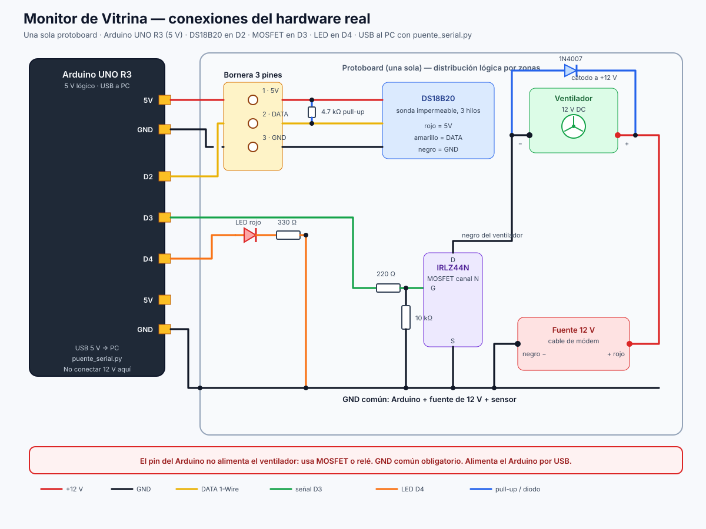

# Hardware real — Arduino UNO R3 + DS18B20 + ventilador 12 V

Este documento adapta el proyecto a los componentes disponibles y a **una sola
protoboard**, usando un **Arduino UNO R3** en lugar del ESP32.

## 1. Cambio de arquitectura: el UNO no tiene WiFi

El Arduino UNO R3 no se conecta solo a la red. La arquitectura queda así:

```
Arduino UNO R3 ──USB──> PC ──HTTP──> Backend Flask/SQLite ──> Interfaz web
   (mide y actúa)      (puente_serial.py)
```

- El Arduino lee el DS18B20 y controla el ventilador y el LED.
- Envía cada lectura por **USB serie** (`L,<temperatura>,<ventilador>,<sensor_ok>`).
- `puente_serial.py` la recibe en el PC, la publica en `POST /lecturas` y le
  devuelve al Arduino la orden `V,<0|1>` y el intervalo `I,<segundos>`.
- El backend y la interfaz web **no cambian**; siguen funcionando igual.

> Si más adelante quieren WiFi sin PC, se puede agregar un módulo ESP-01/WiFi
> shield o volver a la versión ESP32 que quedó en `firmware/esp32/main.py`.
> Con los componentes actuales, el puente USB es la opción más simple y estable.

## 2. Advertencia importante

Un pin digital del Arduino UNO entrega **5 V y como máximo 20–40 mA**. **No puede
alimentar ni conmutar un ventilador de 12 V directamente.** Si se conecta el
ventilador a un pin, el Arduino se reinicia o se daña.

Para encenderlo y apagarlo se necesita **un interruptor electrónico**:

| Opción | Componentes | Cuándo usarla |
|---|---|---|
| **MOSFET canal N logic-level** (recomendado) | IRLZ44N o IRL540N, resistencia 220 Ω, resistencia 10 kΩ, diodo 1N4007 | Silencioso, rápido, sin desgaste mecánico |
| **Módulo relé** | Relé de 5 V con optoacoplador | Si ya lo tienen o prefieren aislamiento galvánico |
| **Solo LED** | Ninguno adicional | Demostración: el ventilador queda directo a 12 V y el LED solo indica la orden |

> Con los componentes listados (bornera, protoboard, DS18B20, jumpers, fuente
> 12 V, LED rojo y una resistencia) **no es posible conmutar el ventilador**.
> Hace falta el MOSFET (o el relé) y, como mínimo, el diodo de protección.
> Si no se consigue, usar `TIPO_SALIDA 2` en el firmware: el sistema mide y
> registra, pero el ventilador no se controla.

### Materiales y cantidades

| Material | Cant. | Para qué |
|---|---|---|
| Arduino UNO R3 | 1 | Control y lectura |
| Cable USB | 1 | Alimentación y comunicación con el PC |
| Protoboard | 1 | Montaje |
| DS18B20 (sonda 3 hilos) | 1 | Medir temperatura |
| Bornera 3 pines | 1 | Conectar el DS18B20 |
| Jumpers | ~12 | Conexiones |
| Fuente 12 V DC | 1 | Alimentar el ventilador |
| Ventilador 12 V | 1 | Enfriamiento |
| LED rojo | 1 | Indicador de enfriamiento |
| Resistencia **4.7 kΩ** | 1 | Pull-up del DS18B20 (**obligatoria**) |
| Resistencia **330 Ω** | 1 | Limitar corriente del LED |
| Resistencia **220 Ω** | 1 | Gate del MOSFET |
| Resistencia **10 kΩ** | 1 | Gate–source (evita encendidos falsos) |
| MOSFET IRLZ44N / IRL540N | 1 | Conmutar el ventilador |
| Diodo 1N4007 | 1 | Protección del MOSFET |

> **Ojo con la resistencia única:** el DS18B20 necesita 4.7 kΩ entre DATA y 5 V;
> sin ella el sensor no aparece en el bus. El LED necesita 330 Ω y el MOSFET
> 220 Ω + 10 kΩ. Si solo hay una resistencia, no alcanza para el montaje
> completo: prioriza la de 4.7 kΩ para el sensor y usa `TIPO_SALIDA 2` hasta
> conseguir las demás.

## 3. Mapa de pines (Arduino UNO R3)

Se eligieron **D2, D3 y D4** porque están juntos en el header digital, no se
usan para el USB serie (D0/D1) y dejan libre el resto de pines. El Arduino
trabaja a **5 V**, así que el DS18B20 se alimenta a 5 V y el pull-up también va
a 5 V.

| Componente | Terminal | Pin Arduino | Notas |
|---|---|---|---|
| **DS18B20** | VCC (rojo) | **5V** | Bornera, pin 1 |
| | DATA (amarillo) | **D2** | Bornera, pin 2 |
| | GND (negro) | **GND** | Bornera, pin 3 |
| **Pull-up DS18B20** | 4.7 kΩ | entre **5V** y **D2** | Obligatoria |
| **LED rojo** | Ánodo | **D4** | A través de 330 Ω |
| | Cátodo | **GND** | |
| **MOSFET IRLZ44N** | Gate (G) | **D3** | A través de 220 Ω |
| | Gate–Source | **10 kΩ a GND** | Evita encendidos falsos |
| | Source (S) | **GND común** | |
| | Drain (D) | **Negro del ventilador** | |
| **Ventilador 12 V** | Rojo (+) | **+12 V** | Fuente de módem |
| | Negro (–) | **Drain del MOSFET** | |
| **Diodo 1N4007** | Cátodo (raya) | **+12 V** | En paralelo con el ventilador |
| | Ánodo | **Drain / negro del ventilador** | Protege el MOSFET |
| **Fuente 12 V** | Rojo (+) | **+12 V** del ventilador | Verificar polaridad |
| | Negro (–) | **GND común** | Unir con GND del Arduino |
| **Arduino** | Alimentación | **USB 5 V** | No conectar los 12 V al Arduino |

> **Pines reservados:** D0 (RX) y D1 (TX) son el USB serie que usa
> `puente_serial.py`. No conectar nada ahí.
>
> **MOSFET:** usar uno **logic-level** (IRLZ44N o IRL540N). Un IRF540N común
> puede no abrir bien con solo 5 V en el gate.

### Alternativa con módulo relé

| Relé | Conexión |
|---|---|
| `IN` | **D3** |
| `VCC` | **5V** |
| `GND` | **GND común** |
| `COM` | **+12 V** de la fuente |
| `NO` | **Rojo del ventilador** |
| Negro del ventilador | **GND común** |

En el firmware usar `#define TIPO_SALIDA 1` (muchos módulos son activos en bajo).

## 4. Esquema



Versión en texto:

```
Arduino UNO            Bornera 3 pines             DS18B20
5V     ───────────────  pin 1 (5V)   ─────────────  rojo
D2     ───────────────  pin 2 (DATA) ─────────────  amarillo
GND    ───────────────  pin 3 (GND)  ─────────────  negro
                        4.7 kΩ entre pin 1 y pin 2

D4 ── 330 Ω ── LED rojo ── GND

D3 ── 220 Ω ── G  MOSFET N  D ── negro del ventilador
                  |         S ── GND
                 10 kΩ
                  |
                 GND

+12 V ──────────────── rojo del ventilador
+12 V ── cátodo [1N4007] ánodo ── negro del ventilador
negro de la fuente 12 V ─────── GND común con el Arduino

Arduino ──USB──> PC (puente_serial.py + Flask)
```

## 5. Distribución en la única protoboard

El Arduino va **fuera** de la protoboard; se conecta con jumpers. La protoboard
se divide en tres zonas para no mezclar los 12 V con las señales de 5 V:

| Zona | Contenido | Recomendación |
|---|---|---|
| **A — izquierda** | Bornera de 3 pines, resistencia 4.7 kΩ, LED + 330 Ω | Mantener el sensor lejos del MOSFET |
| **B — centro** | MOSFET, 220 Ω de gate, 10 kΩ gate–source | Cerca del ventilador |
| **C — derecha** | Diodo 1N4007, salida al ventilador, entrada 12 V | Cables de 12 V cortos y cubiertos |
| **Riel inferior** | **GND común** | Unir GND del Arduino y negro de la fuente |
| **Riel superior** | Solo **5 V** | **No** poner 12 V en este riel |

Pasos sugeridos:

1. Con el Arduino desconectado, montar la bornera y el pull-up de 4.7 kΩ.
2. Montar el LED con su resistencia de 330 Ω.
3. Montar el MOSFET, el divisor de gate (220 Ω + 10 kΩ) y el diodo.
4. Conectar primero **GND común**; después 5 V; al final los 12 V.
5. Revisar con multímetro que no haya continuidad entre +12 V y 5 V/GND.
6. Alimentar el Arduino por USB y el ventilador con la fuente de 12 V.

## 6. Firmware del Arduino

Archivo: **`firmware/arduino_uno/arduino_uno.ino`**

1. Abrir Arduino IDE.
2. Instalar las librerías **OneWire** (Paul Stoffregen) y
   **DallasTemperature** (Miles Burton) desde el Library Manager.
3. Seleccionar **Arduino Uno** y el puerto COM donde apareció la placa.
4. Ajustar el modo de salida al inicio del archivo:

```cpp
// 0 = MOSFET (activo en alto), 1 = relé (activo en bajo), 2 = solo LED
#define TIPO_SALIDA 0
```

5. Subir el sketch.
6. Abrir el Monitor Serie a **115200 baudios** para ver `READY,Arduino UNO R3`
   y las líneas `L,...`. **Cerrar el Monitor Serie** antes de ejecutar el
   puente, porque el puerto solo lo puede usar un programa a la vez.

El firmware también tiene una **regla local de respaldo**: si el PC/backend no
responde durante unos 3 intervalos, enciende el ventilador sobre 6 °C y lo apaga
con histéresis en 5 °C.

## 7. Puente USB-serie

Archivo: **`puente_serial.py`**

```bash
pip install pyserial requests
python puente_serial.py COM3          # Windows
python puente_serial.py /dev/ttyUSB0  # Linux
```

Antes de ejecutarlo, el backend debe estar corriendo:

```bash
cd backend
python app.py
```

El puente:

1. Abre el puerto a 115200 baudios y espera 2 s (el Arduino se reinicia al abrir el puerto).
2. Lee las líneas `L,...` o `E,...`.
3. Las publica en `http://127.0.0.1:5000/lecturas`.
4. Envía al Arduino `V,1`/`V,0` y `I,<segundos>` según la respuesta.

Si el Arduino está en otro PC, cambia `URL_BACKEND` en `puente_serial.py` por la
IP del servidor. Si el puerto no aparece en Windows, instalar el driver **CH340**
(clones de UNO) o revisar el Administrador de dispositivos.

### Protocolo

| Dirección | Línea | Significado |
|---|---|---|
| Arduino → PC | `L,4.25,1,1` | Temperatura 4.25 °C, ventilador encendido, sensor OK |
| Arduino → PC | `L,4.25,0,1` | Temperatura 4.25 °C, ventilador apagado, sensor OK |
| Arduino → PC | `E,0` | Sensor desconectado, ventilador apagado |
| PC → Arduino | `V,1` | Encender ventilador |
| PC → Arduino | `V,0` | Apagar ventilador |
| PC → Arduino | `I,1` | Leer cada 1 segundo (mínimo) |

## 8. Backend adaptado

Se mantiene la misma API y la misma base de datos. Las rutas nuevas son:

| Ruta | Uso |
|---|---|
| `GET /hardware` | Devuelve el mapa de pines del Arduino y el protocolo serie |
| `GET /salud` | Prueba de conectividad del puente |

La respuesta de `POST /lecturas` incluye:

```json
{
  "estado": "FUERA_RANGO_ALTO",
  "ventilador": true,
  "led": true,
  "salida": { "ventilador": true, "led": true },
  "sensor_ok": true,
  "intervalo": 1,
  "modo": "auto"
}
```

`led` es un alias de `ventilador`: el LED rojo indica que la orden de
enfriamiento está activa. El puente usa `ventilador` para enviar `V,1`/`V,0`.
No se modificó el esquema de la base de datos.

## 9. Pruebas antes de conectar todo

### 9.1 Fuente de 12 V

Con multímetro, medir la salida del cable del módem:

- Debe dar aproximadamente **12 V DC**.
- Identificar **rojo = positivo** y **negro = negativo**.
- Si el cable es de corriente alterna (AC), **no usarlo**.

### 9.2 DS18B20 solo

Con el Arduino cargado con un ejemplo de `DallasTemperature` (o el firmware
final), abrir el Monitor Serie a 115200 y verificar que aparezca una temperatura
coherente. Si el sensor no aparece:

- Revisar 5 V, GND y DATA en D2.
- Revisar la resistencia de 4.7 kΩ entre DATA y 5 V.
- Revisar que el cable no esté invertido.

### 9.3 LED y MOSFET

Con un sketch mínimo o con el firmware:

```cpp
digitalWrite(4, HIGH);   // LED encendido
digitalWrite(4, LOW);    // LED apagado
digitalWrite(3, HIGH);   // MOSFET: ventilador encendido
digitalWrite(3, LOW);    // MOSFET: ventilador apagado
```

Si usan relé activo en bajo, el ventilador se enciende con `digitalWrite(3, LOW)`.

### 9.4 Puente y backend

```bash
curl http://127.0.0.1:5000/salud
curl http://127.0.0.1:5000/hardware
```

Luego ejecutar el puente y ver en la consola las líneas `T=... C | estado=...`.
También se puede simular una lectura alta sin Arduino:

```bash
curl -X POST http://127.0.0.1:5000/lecturas -H "Content-Type: application/json" -d "{\"id_vitrina\":1,\"temperatura\":9,\"ventilador\":false}"
```

Debe responder `"ventilador": true` y `"led": true`. Con `temperatura: 4` debe
apagar.

## 10. Problemas comunes

| Síntoma | Causa probable | Solución |
|---|---|---|
| No aparece el puerto COM | Driver CH340 o cable solo de carga | Instalar driver; usar cable USB de datos |
| Monitor Serie muestra basura | Baudios incorrectos | Poner 115200 |
| `puente_serial.py` no abre el puerto | Monitor Serie abierto | Cerrar el Monitor Serie |
| DS18B20 marca `-127` o `85` | Sin pull-up, cables invertidos o sin 5 V | 4.7 kΩ entre DATA y 5 V; revisar cableado |
| LED enciende pero el ventilador no | MOSFET mal cableado o sin GND común | Gate a D3, source a GND, drain al negro del ventilador |
| Ventilador siempre encendido | Gate flotante, drain/source invertidos o relé activo en bajo | Poner 10 kΩ gate–source; revisar pines; usar `TIPO_SALIDA 1` |
| El Arduino se reinicia al arrancar el ventilador | 12 V conectado al Arduino o falta diodo | Alimentar por USB, GND común y 1N4007 en paralelo con el ventilador |
| La interfaz dice "sin conexión" | Backend apagado, IP incorrecta o firewall | Iniciar `app.py`; probar `/salud`; abrir puerto 5000 |
| El ventilador gira al revés | Polaridad del ventilador | Invertir rojo/negro del ventilador (no de la fuente) |

## 11. Seguridad

- No conectar **12 V** a los pines **5V, 3V3, D2, D3, D4** del Arduino.
- Unir siempre el **GND** de la fuente de 12 V con el **GND** del Arduino.
- El diodo **1N4007** no es opcional: sin él, el motor genera picos que pueden
  destruir el MOSFET o reiniciar el Arduino.
- No dejar cables pelados de 12 V sobre la protoboard; usar terminales o
  cubrir las uniones.
- Si se usa relé, preferir módulo con optoacoplador y no alimentar la bobina
  desde un pin digital.
- El Arduino UNO se alimenta por **USB**; no usar los 12 V del ventilador para
  alimentarlo.
